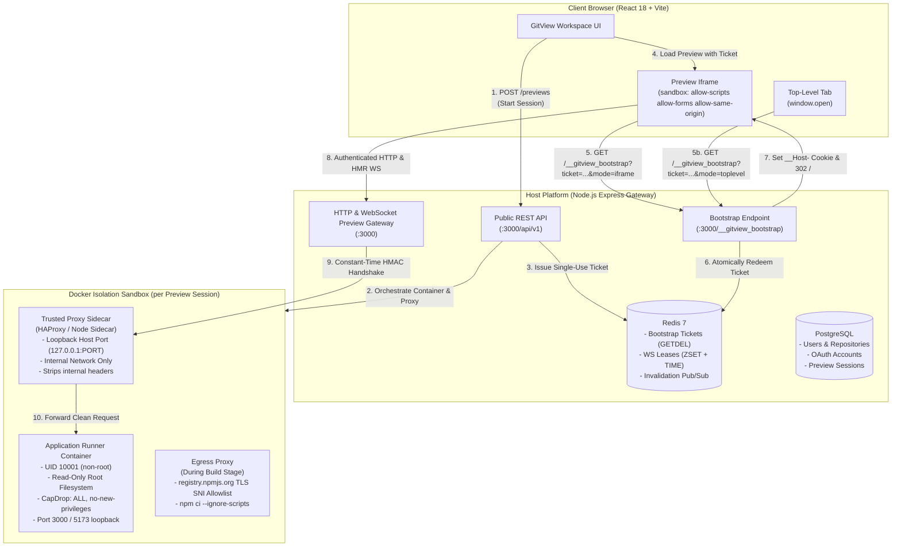

# GitView — Cloud-Native Live Repository Preview Platform

GitView is a secure full-stack web application that allows developers to paste a GitHub repository URL, instantly explore its source code, inspect dependencies, and launch supported repositories in isolated, containerized cloud environments with live Hot Module Replacement (HMR) and Fast Refresh.

---

## 1. System Architecture



---

## 2. Tech Stack

- **Frontend**: React 18, Vite 5, Tailwind CSS, React Router 6, Axios, Monaco Editor, KaTeX.
- **Backend**: Node.js 22+, Express 5, Prisma 7, PostgreSQL, Redis 7 (ioredis), bcrypt, jsonwebtoken.
- **Preview Isolation**: Docker Engine 24+, HAProxy, Linux Namespaces, cgroups v2, Capabilities dropping (`cap-drop: ALL`), non-root UID 10001 execution, and `--read-only` root filesystems.
- **Testing**: Vitest 5, Playwright 1.65, Supertest 7, Docker integration test harness.

---

## 3. Quick Start & Developer Setup

### 3.1 Prerequisites
- **Node.js**: `v22.18.0` or newer (`node -v`)
- **Docker Engine**: Docker 24.0+ running with loopback port publishing enabled (`docker info`)
- **PostgreSQL**: PostgreSQL 14+ running locally on port 5432 (`psql -U postgres`)
- **Redis**: Redis 7+ running locally on port 6379 (`redis-cli ping`)
- **GitHub CLI (optional for live import)**: `gh auth token` for E2E GitHub integration

### 3.2 Backend Configuration
```bash
cd server

# 1. Install dependencies
npm install

# 2. Configure environment
cp .env.example .env
# Ensure DATABASE_URL, REDIS_URL, and cryptographic keys are set in server/.env:
# ENCRYPTION_KEY, PREVIEW_TOKEN_ENCRYPTION_KEY, and GITVIEW_SIDECAR_HANDSHAKE_KEY
# must each be 64-character hexadecimal strings (32 cryptographically random bytes).

# 3. Database migrations
npm run db:generate
npm run db:migrate

# 4. Start backend server
npm run dev
# Server starts at http://localhost:3000
```

### 3.3 Frontend Configuration
```bash
cd client

# 1. Install dependencies
npm install

# 2. Configure environment
cp .env.example .env
# VITE_API_BASE_URL=http://localhost:3000/api/v1

# 3. Start frontend dev server
npm run dev
# Client runs at http://localhost:5173
```

---

## 4. Automated Testing & Verification Portfolio

GitView Phase 5 maintains a comprehensive test suite across unit, integration, browser E2E, and live Docker acceptance layers:

```bash
# 1. Run full backend vitest suite (715 tests across 26 test files)
npm --prefix server test

# 2. Run client vitest suite (34 tests across 3 test files)
npm --prefix client test

# 3. Run Playwright browser E2E test suite (21 tests across 3 spec files)
npm --prefix client run test:e2e

# 4. Run Docker Adapter Security verification (11 security checks)
bash server/docker/verify-docker-adapter.sh

# 5. Run Master Docker Acceptance suite (6 test suites, 21 checks)
bash server/docker/acceptance-tests/run-all.sh

# 6. Run Live HTTP Preview Gateway Acceptance (STATIC, VITE_VANILLA, VITE_REACT)
bash server/docker/verify-preview-gateway.sh

# 7. Run Live WebSocket Gateway Acceptance (RFC 6455 HMR, Fast Refresh, sidecar rotation)
bash server/docker/verify-preview-websocket.sh
```

### Automated Test Accounting Summary
| Test Layer | Test Files / Scope | Total Tests / Checks | Pass Rate | Status |
| :--- | :--- | :---: | :---: | :---: |
| Backend Vitest Suite | 26 test files | 715 tests | 100% (715 / 715) | PASS |
| Client Vitest Suite | 3 test files | 34 tests | 100% (34 / 34) | PASS |
| Playwright Browser E2E Suite | 3 spec files | 21 tests | 100% (21 / 21) | PASS |
| Docker Adapter Security Checks | 1 verification suite | 11 checks | 100% (11 / 11) | PASS |
| Master Docker Acceptance Suite | 6 test suites | 21 checks | 100% (6 / 6 suites) | PASS |
| Live Gateway HTTP Demonstrations | 1 live scenario script | 3 scenarios | 100% (3 / 3) | PASS |
| Live Gateway WebSocket Checks | 1 live verification script | 7 checks | 100% (7 / 7) | PASS |

> **Note**: Test layers reflect distinct verification boundaries (unit, browser DOM, container lifecycle, and live proxying) and are reported individually without combining overlapping checks into an artificial aggregate.

---

## 5. Security Architecture & Guarantees

1. **Partitioned `__Host-` Capability Cookies (RFC 6265bis §4.1.3.1 + CHIPS)**:
   - Core preview capability tokens are held in partitioned cookies with the `__Host-` prefix.
   - Enforces `Secure: true`, `Path: '/'`, `HttpOnly: true`, and strictly NO `Domain` attribute.
   - Subdomains cannot overwrite, forge, or shadow capability cookies.
2. **Strict Single-Use Ticket Exchange**:
   - Tickets are generated as 32-byte (64 hex character) cryptographically random values.
   - Stored in Redis with 30-second TTL and consumed atomically via Redis `GETDEL` Lua scripts.
   - Separate mode binding: `iframe` tickets are strictly partitioned for embedded frames; `toplevel` tickets are strictly bound for external tab navigation.
3. **Hardened Dual-Proxy Isolation**:
   - Application runners execute on internal-only Docker bridge networks with ZERO host-published ports and ZERO direct external connectivity.
   - The trusted proxy sidecar terminates loopback traffic on dynamic ports (`127.0.0.1:PORT`) and strips internal routing headers before proxying.
   - Gateway-to-sidecar handshake enforces constant-time HMAC-SHA256 validation bound to the immutable sidecar instance identity (`proxyInstanceId`).
4. **Content-Security-Policy & Defensive Headers (`previewCsp.js`)**:
   - Every preview response is governed by mandatory server-side CSP:
     - `default-src 'none'` (fail-closed baseline, strictly blocking arbitrary content).
     - `script-src 'self' 'unsafe-inline' 'unsafe-eval' blob: https:` (Vite HMR/React) or `'self' 'unsafe-inline' https:` (Static).
     - `connect-src 'self' ws: wss: https: blob: data:` (dev) or `'self' wss: https: blob: data:` (prod).
     - `frame-ancestors`: Strictly environment-segregated to the exact host origin — `FRAME_ANCESTORS_DEV = 'http://localhost:5173'` in development, `FRAME_ANCESTORS_PROD = 'https://app.gitview.dev'` in production (never wildcards like `http://localhost:*` or `127.0.0.1:*`).
     - Strips conflicting `X-Frame-Options` so `frame-ancestors` has uncontested authority.
   - Imported application code cannot override mandatory GitView framing policies.
5. **Distributed WebSocket Leases & Server Clock Consistency**:
   - Distributed connection limit enforced across gateway instances (10 concurrent connections per session).
   - Redis Sorted Set tracking (`preview:ws:leases:<sessionId>`) with authoritative Redis server time (`TIME`) inside Lua scripts eliminates gateway clock-drift vulnerabilities.
   - Key-level auto-cleanup (`PEXPIRE`) and background heartbeats prevent orphaned leases after gateway crashes.

---

## 6. Production Deployment Readiness Checklist

| Requirement | Local Development Status | Production Deployment Status | Action Required for Production |
| :--- | :--- | :--- | :--- |
| **Wildcard TLS / HTTPS** | `http://*.preview.localhost:3000` | Mandatory HTTPS (`https://*.preview.domain.com`) | Provision wildcard SSL certificate (`*.preview.domain.com`) on reverse proxy (Nginx/Cloudflare/AWS ALB). |
| **Host Header Integrity & Proxies** | Validated via `validateHostHeader` & loopback check | Strict CIDR subnet matching (`trustedProxy.js`) | Configure `TRUSTED_PROXIES` with trusted reverse proxy CIDR subnets (e.g. `10.0.0.0/8, 172.16.0.0/12, 192.168.0.0/16` or ALB IP) rather than blind boolean/hop-count `trust proxy` in Express. Untrusted immediate peers have all `X-Forwarded-*` headers stripped and fail closed. |
| **Redis Persistence** | Redis 7 container on port 6379 | Managed Redis / Redis Cluster | Enable AOF/RDB persistence and TLS (`rediss://`). |
| **PostgreSQL Database** | Local PostgreSQL 14+ | Managed PostgreSQL (RDS/Cloud SQL) | Run `npm run db:deploy` in deployment pipeline. |
| **Docker Resource Limits** | Monitored 512MB RAM, 1.0 CPU, 300MB disk | Enforced via cgroups v2 | Pin base Docker image digests (`gitview-preview-runner@sha256:...`). |
| **Cryptographic Secrets** | `.env` variables | Secret Store (KMS, Vault, AWS Secrets Manager) | Inject distinct, 64-hex secrets for `ENCRYPTION_KEY`, `PREVIEW_TOKEN_ENCRYPTION_KEY`, and `GITVIEW_SIDECAR_HANDSHAKE_KEY`. |
| **Orphan Cleanup Reaper** | On startup & explicit tests | Continuous cron reaper process | Run `PreviewManager.startReconciliationJob()` on worker service. |

---

## 7. Security Residual Risk Register

| Risk ID | Threat Scenario | Likelihood | Impact | Applied Mitigation | Accepted Residual Risk Justification |
| :--- | :--- | :--- | :--- | :--- | :--- |
| **RR-01** | Malicious NPM package attempts outbound data exfiltration during build | Low | High | Egress proxy with strict TLS SNI inspection (`registry.npmjs.org`), ECH rejection, private IP blocking, anti-DNS rebinding, and `--ignore-scripts`. | Outbound traffic to the official NPM registry domain is permitted for fetching dependencies. |
| **RR-02** | User code attempts local filesystem tampering | Very Low | High | Runner container executes as UID 10001 with read-only rootfs (`--read-only`), all Linux capabilities dropped (`cap-drop: ALL`), and `no-new-privileges`. | Code can only write to its ephemeral, quota-capped `/workspace` volume and tmpfs `/tmp`. |
| **RR-03** | Port scanning / lateral movement in Docker daemon | Negligible | Critical | Runners are attached to an `--internal` network with no external gateway; only the trusted sidecar connects across networks. | Linux kernel network namespace isolation enforces strict packet filtering between sessions. |
| **RR-04** | Iframe breakout / Clickjacking | Very Low | High | `sandbox="allow-scripts allow-forms allow-same-origin"` strictly omits `allow-top-navigation` and `allow-popups-to-escape-sandbox`. CSP `frame-ancestors` restricts framing. | Same-origin is required for modern SPA execution (`localStorage`, Web Workers), but capability token isolation in `__Host-` cookies protects session integrity. |
| **RR-05** | WebSocket connection exhaustion (DoS) | Very Low | Medium | Distributed Redis Sorted Set lease tracker enforces a hard limit of 10 connections per session across all gateway instances with 5-second heartbeats. | At most 10 concurrent WebSocket connections can be maintained per preview session. |

---

## 8. License & Credits

GitView is engineered following cloud-native security best practices and RFC specifications. Developed as part of GitView Phase 5.
