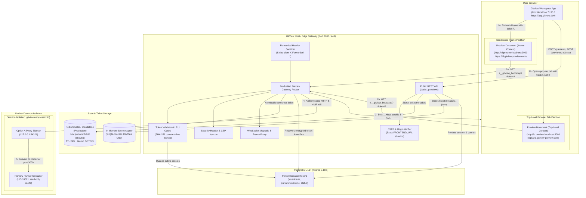
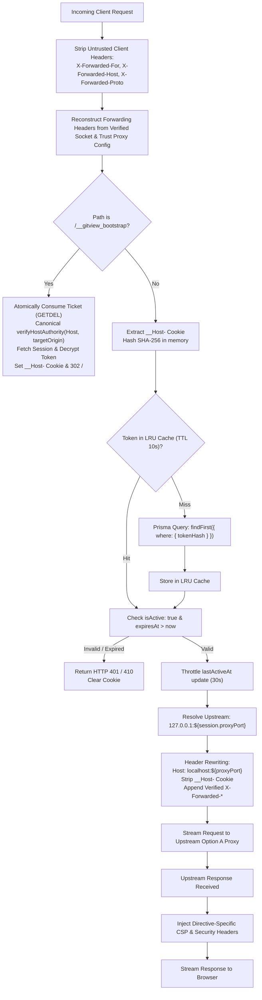
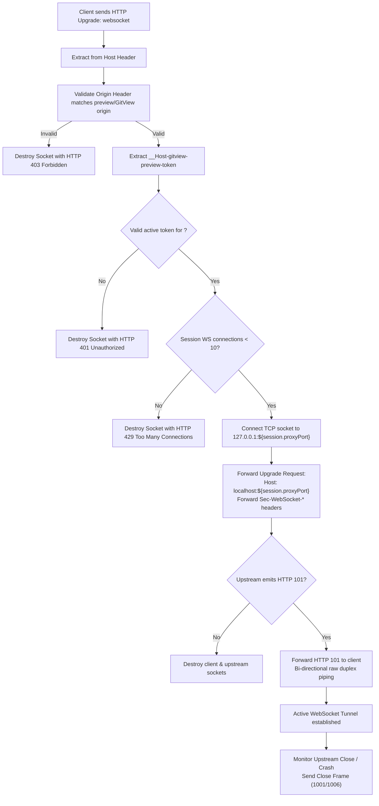

# GitView Phase 5 — Milestone 7: Production Preview Gateway & Browser Authentication Architecture (v1.2)

> **Document Status**: Architecture & Implementation Specification Only  
> **Version**: 1.2.0 (Canonical Host Normalization & Directive-Specific CSP Matrix)  
> **Scope**: Architecture and feasibility specification for Milestone 7. Strictly no modifications to application code, Prisma schemas, migrations, or frontend files until this architecture is formally reviewed and approved.  
> **Classification**:
> - **[APPROVED ARCHITECTURE DECISION]**: Established designs from Milestones 1–6 (PreviewManager, DockerAdapter, dual-network build isolation, Option A sidecar).
> - **[MILESTONE 7 SPECIFICATION]**: Technical requirements and interfaces designed for Milestone 7 implementation.
> - **[SECURITY CORRECTION v1.2]**: Mandatory architectural hardening approved in the v1.2 review cycle.

---

## Change Log

### Changes in v1.2: Canonical Host Normalization & Directive-Specific CSP
1. **Canonical WHATWG Host Authority Normalization (§3.3, §5.2, §10, §12.1)**:
   - Replaced naive string equality (`request.headers.host === payload.targetOrigin`) with strict canonical parsing.
   - Parses the server-generated `targetOrigin` using WHATWG `new URL(targetOrigin)`. Compares normalized `url.hostname` (lowercase, IPv6 brackets preserved) and `url.port` (explicit or default 80/443) against the incoming `Host` authority.
   - Enforces rejection of:
     - Malformed authorities (characters `@`, `/`, `\`, `?`, `#`, or whitespace).
     - User credentials (e.g. `user:pass@host`).
     - Duplicate or comma-separated `Host` headers.
     - Unexpected, non-matching, or omitted ports.
     - Disparate session IDs in subdomain authorities.
   - Explicitly forbids deriving the expected target origin from client-supplied forwarding headers.
   - Provided concrete examples for development and production hostnames, and added positive/negative test cases to the Tier 1 acceptance matrix.
2. **Directive-Specific & Environment-Segregated CSP Policy Matrix (§6.1, §6.2)**:
   - Replaced broad `default-src` fallback with explicit, fine-grained directives:
     `default-src 'none'`, `script-src`, `style-src`, `img-src`, `font-src`, `connect-src`, `worker-src`, `object-src 'none'`, `base-uri 'self'`, `frame-ancestors`.
   - Segregated parent framing permissions by environment:
     - Development: `frame-ancestors http://localhost:5173`
     - Production: `frame-ancestors https://app.gitview.dev`
     - Strictly forbids including both parent origins indiscriminately.
   - Preserved Vite development requirements: `'unsafe-inline'`, `'unsafe-eval'`, `blob:`, `ws:`, `wss:`.
   - Documented preview external resource compatibility policy: allows external fonts, images, and CDNs over HTTPS.
   - Explicitly clarified that CSP is defense-in-depth and cannot replace Origin Separation and Iframe Sandboxing.
   - Provided the exact final proposed CSP headers for:
     1. Development STATIC Previews.
     2. Development Vite Previews.
     3. Production Previews.

### Changes in v1.1: Redis Registry, POST Ticket, CHIPS, & Header Sanitization
1. **Redis-Backed Production Ticket Registry (§3.2, §10)**:
   - Replaced in-memory production ticket storage with a horizontally scalable, Redis-backed ticket registry.
   - Keys store `preview:ticket:${sha256(ticket)}` with a strict 30-second TTL (`EX 30`).
   - Metadata stores `{ sessionId, targetOrigin, expiresAt }`. Zero capability tokens in Redis.
   - Atomic single-use consumption enforced via `GETDEL` (Redis 6.2+) or Lua script.
   - On redemption, recovers encrypted token from PostgreSQL (`decryptPreviewToken(session.previewTokenEnc)`).
   - In-memory adapter retained for single-process local development with documented limitations.
2. **Bootstrap Ticket Creation via POST (§7.2, §7.3)**:
   - Replaced `GET /api/v1/previews/:id/url` with `POST /api/v1/previews/:id/ticket`.
   - Enforced non-safe HTTP `POST` semantics, authentication, session ownership, `RUNNING` status, CSRF protection, exact Origin verification, rate limits, `Cache-Control: no-store`, and zero ticket logging.
3. **CHIPS Partitioning & Top-Level Preview Navigation (§2.2, §4.2, §11.1, §11.2)**:
   - Documented that partitioned cookies (`Partitioned`) created inside an iframe are bound to the parent partition and do not authenticate top-level tabs.
   - Defined dedicated "Open in New Tab" flow requesting a fresh bootstrap ticket.
   - Added browser compatibility matrix (Chrome, Firefox, Safari) and local HTTPS certificate strategy (`mkcert`) for Safari. Mandated no insecure cookie fallback.
4. **CSRF Protection & Forwarded-Header Sanitization (§5.2, §7.1)**:
   - Mandated exact Origin allowlisting against `new URL(env.FRONTEND_URL).origin` and `Content-Type: application/json`.
   - Stripped client-supplied `X-Forwarded-*` headers; reconstructed telemetry from verified sockets.
5. **Bootstrap URL Leakage Protection (§3.3)**:
   - Injected `Cache-Control: no-store`, `Referrer-Policy: no-referrer`, query-string log redaction, and immediate `302` redirect with an empty body (0 bytes).

---

## 1. Component and Network Architecture

### 1.1 Architectural Topology

The production preview gateway acts as an authenticated, origin-isolating edge proxy between user browsers and isolated backend runner containers.



---

## 2. Preview Domain and Origin Isolation

### 2.1 Comparative Analysis: Subdomain vs Port-Based Isolation

```
+------------------------+------------------------------------+----------------------------------------+
| EVALUATION CRITERION   | PORT-BASED ISOLATION               | SUBDOMAIN-BASED ISOLATION              |
|                        | (localhost:3001 vs localhost:3002) | (<id>.preview.localhost:3000)          |
+------------------------+------------------------------------+----------------------------------------+
| Same-Origin Policy     | Separate storage partitions        | Separate storage partitions            |
| (DOM & Storage)        | (scheme, host, port)               | (scheme, host, port)                   |
+------------------------+------------------------------------+----------------------------------------+
| Cookie Scoping         | FAILED: RFC 6265 cookie rules      | PASSED: Host-only cookies on subdomains|
| (CRITICAL DEFENSE)     | ignore port numbers. Cookies set   | are completely isolated. Subdomain A   |
|                        | on localhost:3001 are sent to      | cannot read or write Subdomain B or    |
|                        | localhost:3002 and localhost:5173. | parent localhost cookies.              |
+------------------------+------------------------------------+----------------------------------------+
| Host-Only Prefix       | Collides across all sessions on    | Perfectly partitioned. Each preview    |
| (__Host-)              | the shared hostname localhost.     | has a unique fully qualified domain.   |
+------------------------+------------------------------------+----------------------------------------+
| Port & Firewall Mgmt   | Requires dynamic port pools and    | Single ingress port (3000 in dev,      |
|                        | firewall rules on host.            | 443 in production).                    |
+------------------------+------------------------------------+----------------------------------------+
```

> [!CRITICAL]
> **Port-based preview isolation is permanently rejected.** Under RFC 6265, browser cookie scoping does not respect port numbers. Any cookie stored under `http://localhost:3001` is accessible to `http://localhost:3002` and the GitView web application running on `http://localhost:5173`. Subdomain-based isolation is mandatory.

### 2.2 Selected Strategy: Development vs Production

```
+----------------------------------------------------------------------------------------------------+
| ENVIRONMENT          | PREVIEW ORIGIN FORMAT                        | PARENT APP ORIGIN            |
+----------------------+----------------------------------------------+------------------------------+
| Development (Local)  | http://<opaque-id>.preview.localhost:3000     | http://localhost:5173        |
| Production (Cloud)   | https://<opaque-id>.gitview-preview.com      | https://app.gitview.dev      |
+----------------------------------------------------------------------------------------------------+
```

#### Development: `*.preview.localhost` via RFC 6761
- **RFC 6761 Special-Use Domain**: Section 6.3 mandates that browser network resolvers (Chromium, Firefox, WebKit) resolve all `*.localhost` subdomains directly to loopback (`127.0.0.1` and `::1`) without issuing network DNS queries or requiring `/etc/hosts` modifications.
- **W3C Secure Context**: Modern Chromium and Firefox treat `http://*.localhost` as a **Secure Context** (`isSecureContext === true`), permitting the `Secure` cookie flag over plain HTTP during local development.
- **Safari Localhost Caveat**: Safari / WebKit does not consistently grant Secure Context privileges to arbitrary multi-level subdomains over plain HTTP localhost. See §11 for the local HTTPS certificate strategy.

#### Production: Dedicated Preview Domain (`*.gitview-preview.com`)
- **Full eTLD+1 Isolation**: By hosting previews on a completely distinct registrable domain (`gitview-preview.com`) from the main GitView application (`gitview.dev`), the architecture eliminates:
  - Domain-wide cookie leakage (`Domain=.gitview.dev`).
  - Shared Web Storage, CacheStorage, or Service Worker contamination.
  - SameSite lax-by-default cross-subdomain sharing.
- **Wildcard DNS & TLS**: A single wildcard DNS record `*.gitview-preview.com` points to the GitView Edge Load Balancer, secured by a wildcard TLS certificate (`*.gitview-preview.com`).

---

## 3. Preview-Token Authentication & Redis Ticket Registry

### 3.1 Security Risks of Naive Authentication

1. **Tokens in Query Strings (`?token=rawToken`)**:
   - Persists in browser navigation history.
   - Leaks via the `Referer` HTTP request header when the application loads external images, fonts, or CDN scripts.
   - Leaks to server access logs and telemetry.
   - Directly readable by imported, untrusted JavaScript via `window.location.search`.
2. **Tokens in LocalStorage or `document.cookie`**:
   - Untrusted application scripts executing inside the preview can exfiltrate the token to an external attacker-controlled server.
3. **No Authentication on Subresources**:
   - Once the HTML loads, Vite dev servers request hundreds of dynamic modules (`/@vite/client`, `/src/App.jsx`, node_modules). Every single request must be authenticated without requiring custom headers on native browser `<script>` tags.

### 3.2 Production Redis-Backed Ticket Registry Architecture

In a horizontally scaled production deployment with multiple backend/gateway instances, ticket issuance and redemption cannot rely on in-process memory.

```
+----------------------------------------------------------------------------------------------------+
| REDIS KEY PATTERN        | VALUE PAYLOAD                                   | TTL                   |
+--------------------------+-------------------------------------------------+-----------------------+
| preview:ticket:<hash>    | {"sessionId":"<uuid>","targetOrigin":"<origin>"} | 30 seconds (EX 30)    |
+--------------------------+-------------------------------------------------+-----------------------+
```

#### Invariants:
1. **Key Hashing**: Keys are stored as the SHA-256 hash of the ticket string (`crypto.createHash('sha256').update(rawTicket).digest('hex')`). An attacker inspecting Redis keys cannot observe plaintext ticket strings.
2. **Zero Capability Tokens in Redis**: The payload stores **only** `{ sessionId, targetOrigin, expiresAt }`. The raw preview capability token is **never** written to Redis.
3. **Atomic Single-Use Consumption**:
   - For Redis 6.2+: Uses native `GETDEL`:
     ```bash
     GETDEL preview:ticket:<sha256>
     ```
   - For pre-6.2 or Redis Cluster environments: Uses an atomic Lua script:
     ```lua
     local val = redis.call('GET', KEYS[1])
     if val then redis.call('DEL', KEYS[1]) end
     return val
     ```
4. **Server-Side Token Recovery**:
   - Upon successful atomic retrieval, the Gateway fetches the `PreviewSession` record from PostgreSQL:
     ```js
     const session = await prisma.previewSession.findUnique({ where: { id: payload.sessionId } });
     ```
   - Verifies:
     - `session.status === PreviewStatus.RUNNING`
     - `session.isActive === true`
     - `session.expiresAt > new Date()`
     - Canonical Host authority matches `payload.targetOrigin` (see §3.3).
   - Decrypts the raw preview token server-side using the existing AES-256-GCM mechanism:
     ```js
     const rawToken = decryptPreviewToken(session.previewTokenEnc);
     ```
   - Issues the host-only cookie.
5. **Local Development In-Memory Adapter**:
   - Implements `ITicketStore` interface:
     - `set(ticketHash, metadata, ttlSeconds)`
     - `consume(ticketHash)`
   - Single-process in-memory `Map` with `setTimeout` TTL cleanup is retained exclusively for local development and unit testing.
   - **Limitation Documented**: In-memory adapter cannot be used across multiple worker processes or containers.

### 3.3 Canonical WHATWG Host Authority Normalization Algorithm

Comparing `req.headers.host === payload.targetOrigin` is incorrect because `targetOrigin` contains an explicit scheme (e.g. `http://`), while the HTTP `Host` header contains authority only (`host[:port]`).

The Gateway enforces a strict canonical parsing and normalization algorithm:

```
+----------------------------------------------------------------------------------------------------+
| PARSING & NORMALIZATION PIPELINE                                                                    |
+----------------------------------------------------------------------------------------------------+
| 1. Server-Generated targetOrigin (WHATWG URL)                                                      |
|    URL: http://a1b2c3d4-e5f6-7890-abcd-ef1234567890.preview.localhost:3000                        |
|    -> targetUrl.hostname = "a1b2c3d4-e5f6-7890-abcd-ef1234567890.preview.localhost" (lowercase)     |
|    -> targetUrl.port     = "3000" (or default 80/443 depending on protocol)                        |
|                                                                                                    |
| 2. Client HTTP Request Host Header                                                                 |
|    Host: a1b2c3d4-e5f6-7890-abcd-ef1234567890.preview.localhost:3000                              |
|    -> Check: Is singular string? No duplicate headers? No comma separations?                      |
|    -> Check: No user credentials (@)? No path separators (/ or \)? No query/hash (? or #)?        |
|    -> Split authority into host + port:                                                            |
|       - IPv6 literal handling: starts with '[', ends with ']' -> lowercase inside brackets          |
|       - DNS hostname handling: split by last ':' -> incomingHostname (lowercase) + incomingPort    |
|    -> Default port assignment: if incomingPort omitted, set 80 (HTTP) or 443 (HTTPS)               |
|                                                                                                    |
| 3. Strict Equality Check                                                                           |
|    Assert: incomingHostname === expectedHostname                                                   |
|    Assert: effectiveIncomingPort === expectedPort                                                  |
|    Assert: incomingHostname.startsWith(session.id + ".")                                           |
+----------------------------------------------------------------------------------------------------+
```

#### Code Specification (`verifyHostAuthority`):
```js
export function verifyHostAuthority(incomingHostHeader, expectedTargetOrigin) {
  // 1. Guard against missing, non-string, or duplicate Host headers
  if (!incomingHostHeader || typeof incomingHostHeader !== 'string' || Array.isArray(incomingHostHeader)) {
    return { valid: false, reason: 'HOST_HEADER_INVALID_TYPE' };
  }
  if (incomingHostHeader.includes(',')) {
    return { valid: false, reason: 'HOST_HEADER_DUPLICATE_OR_MULTIPLE' };
  }

  // 2. Reject credentials, whitespace, path separators, or query markers
  if (/[\/@\\?#\s]/.test(incomingHostHeader)) {
    return { valid: false, reason: 'HOST_HEADER_MALFORMED_CHARACTERS' };
  }

  // 3. Parse expected target origin using Node.js WHATWG URL parser
  let targetUrl;
  try {
    targetUrl = new URL(expectedTargetOrigin);
  } catch {
    return { valid: false, reason: 'TARGET_ORIGIN_MALFORMED' };
  }

  const expectedHostname = targetUrl.hostname.toLowerCase();
  const expectedDefaultPort = targetUrl.protocol === 'https:' ? '443' : '80';
  const expectedPort = targetUrl.port || expectedDefaultPort;

  // 4. Parse incoming Host authority into hostname and port
  let incomingHostname;
  let incomingPort;

  if (incomingHostHeader.startsWith('[')) {
    // IPv6 literal: e.g. "[::1]:3000" or "[::1]"
    const closingBracket = incomingHostHeader.indexOf(']');
    if (closingBracket === -1) {
      return { valid: false, reason: 'HOST_HEADER_INVALID_IPV6' };
    }
    incomingHostname = incomingHostHeader.slice(0, closingBracket + 1).toLowerCase();
    const remainder = incomingHostHeader.slice(closingBracket + 1);
    if (remainder.startsWith(':')) {
      incomingPort = remainder.slice(1);
    } else if (remainder.length > 0) {
      return { valid: false, reason: 'HOST_HEADER_INVALID_IPV6_PORT' };
    }
  } else {
    const colonIdx = incomingHostHeader.lastIndexOf(':');
    if (colonIdx !== -1) {
      incomingHostname = incomingHostHeader.slice(0, colonIdx).toLowerCase();
      incomingPort = incomingHostHeader.slice(colonIdx + 1);
    } else {
      incomingHostname = incomingHostHeader.toLowerCase();
    }
  }

  // 5. Validate port numeric bounds if explicitly supplied
  if (incomingPort !== undefined) {
    if (!/^\d+$/.test(incomingPort)) {
      return { valid: false, reason: 'HOST_HEADER_PORT_NON_NUMERIC' };
    }
    const portNum = parseInt(incomingPort, 10);
    if (portNum <= 0 || portNum > 65535) {
      return { valid: false, reason: 'HOST_HEADER_PORT_OUT_OF_RANGE' };
    }
  }

  const effectiveIncomingPort = incomingPort || expectedDefaultPort;

  // 6. Strict equality comparison of normalized hostname and port
  if (incomingHostname !== expectedHostname) {
    return { valid: false, reason: 'HOST_HEADER_HOSTNAME_MISMATCH' };
  }
  if (effectiveIncomingPort !== expectedPort) {
    return { valid: false, reason: 'HOST_HEADER_PORT_MISMATCH' };
  }

  return { valid: true };
}
```

#### Concrete Examples:

```
+----------------------------------------------------------------------------------------------------+
| ENVIRONMENT | TARGET ORIGIN                                      | INCOMING HOST HEADER             | STATUS | REASON                         |
+-------------+----------------------------------------------------+----------------------------------+--------+--------------------------------+
| Development | http://session-123.preview.localhost:3000          | session-123.preview.localhost:3000| ACCEPT | Exact canonical match          |
| Development | http://session-123.preview.localhost:3000          | SESSION-123.PREVIEW.LOCALHOST:3000| ACCEPT | Case-normalized match          |
| Development | http://session-123.preview.localhost:3000          | session-123.preview.localhost    | REJECT | Missing port (80 != 3000)      |
| Development | http://session-123.preview.localhost:3000          | session-123.preview.localhost:8080| REJECT | Port mismatch (8080 != 3000)   |
| Development | http://session-123.preview.localhost:3000          | session-999.preview.localhost:3000| REJECT | Subdomain session ID mismatch  |
| Development | http://session-123.preview.localhost:3000          | user@session-123.preview.loca... | REJECT | Credential character '@'       |
| Development | http://session-123.preview.localhost:3000          | session-123.preview.localhost:0  | REJECT | Port out of range              |
| Development | http://session-123.preview.localhost:3000          | session-123.preview.loc..., evil | REJECT | Duplicate / multiple header    |
| Production  | https://session-123.gitview-preview.com           | session-123.gitview-preview.com  | ACCEPT | Default port 443 implicit      |
| Production  | https://session-123.gitview-preview.com           | session-123.gitview-preview.com:443| ACCEPT| Explicit default port 443      |
| Production  | https://session-123.gitview-preview.com           | session-123.gitview-preview.com:8443| REJECT| Port mismatch (8443 != 443)    |
| Production  | https://session-123.gitview-preview.com           | gitview-preview.com              | REJECT | Base domain; missing session ID|
+----------------------------------------------------------------------------------------------------+
```

### 3.4 Bootstrap URL Leakage Protection

The one-time ticket in the bootstrap URL is necessary for the browser navigation step. Leakage is strictly prevented through defense-in-depth:

```
[ Browser Navigation ] ──► GET /__gitview_bootstrap?ticket=xyz ──► [ Preview Gateway ]
                                                                           │
                                                                           ├─► 1. Atomically consume ticket (GETDEL)
                                                                           ├─► 2. Recover token from PostgreSQL
                                                                           ├─► 3. Canonical verifyHostAuthority()
                                                                           │
   ◄── HTTP 302 Found (Empty body, 0 bytes) ───────────────────────────────┘
       Location: /
       Set-Cookie: __Host-gitview-preview-token=...; Path=/; Secure; HttpOnly; SameSite=None; Partitioned
       Cache-Control: no-store, no-cache, must-revalidate
       Pragma: no-cache
       Referrer-Policy: no-referrer
```

1. **Immediate 302 Redirection**: The bootstrap endpoint responds immediately with `HTTP 302 Found` (or `303 See Other`) redirecting to `/`.
2. **Zero Content Loading**: The redirect response body is empty (`0` bytes). No HTML, scripts, stylesheets, or external tracking tags load while the ticket is in the URL bar.
3. **HTTP Defensive Headers**:
   - `Cache-Control: no-store, no-cache, must-revalidate` (prevents caching of the URL or redirect in browser disk/memory cache).
   - `Pragma: no-cache` (legacy HTTP/1.0 cache prevention).
   - `Referrer-Policy: no-referrer` (guarantees that even if the browser issues a subresource request during redirect, no `Referer` header is sent).
4. **Access-Log Scrubbing**:
   - Morgan / Pino / Gateway access loggers apply a regex redactor scrubbing `?ticket=[^&]+` to `?ticket=[REDACTED]`.
   - Raw tickets are strictly excluded from all application logs, error traces, and client responses.
5. **Strict Host Verification**: The Gateway rejects any ticket where `verifyHostAuthority(req.headers.host, ticket.targetOrigin)` does not return `{ valid: true }`.

---

## 4. Cookie Policy & CHIPS Partitioning

### 4.1 RFC 6265bis `__Host-` Prefix Rules

The `__Host-` cookie prefix is the strongest security mechanism available in the HTTP state management standard. Browsers reject any cookie bearing this prefix unless it strictly complies with the following invariants:

1. **`Secure` Attribute**: Must be present. Only sent over HTTPS or localhost secure contexts.
2. **No `Domain` Attribute**: Must be completely absent. The cookie is strictly bound to the exact fully qualified hostname that set it. Subdomains or superdomains cannot read or overwrite it.
3. **`Path=/` Attribute**: Must be set to `/`. Subpaths cannot restrict or shadow it.

```http
Set-Cookie: __Host-gitview-preview-token=<rawToken>; Path=/; Secure; HttpOnly; SameSite=None; Partitioned; Max-Age=3600
```

### 4.2 Iframe Partitioning vs Top-Level Navigation Mechanics

Cookies bearing the `Partitioned` attribute (CHIPS) are stored in partitioned cookie jars keyed by the **top-level site** (`eTLD+1`):

```
+----------------------------------------------------------------------------------------------------+
| CONTEXT                    | TOP-LEVEL SITE PARTITION KEY       | COOKIE JAR KEY                   |
+----------------------------+------------------------------------+----------------------------------+
| Iframe inside GitView UI   | http://localhost:5173              | {http://localhost:5173,          |
|                            | (or https://app.gitview.dev)       |  http://<id>.preview.localhost}  |
+----------------------------+------------------------------------+----------------------------------+
| Top-Level Tab (Pop-out)    | http://<id>.preview.localhost:3000 | {http://<id>.preview.localhost,  |
|                            | (or https://<id>.gitview-preview)  |  http://<id>.preview.localhost}  |
+----------------------------+------------------------------------+----------------------------------+
```

#### Why Separate Flows are Mandatory:
- A partitioned cookie set during iframe bootstrap is keyed to `http://localhost:5173`.
- When the user opens the preview in a **new top-level browser tab**, the top-level site partition key changes to `http://<id>.preview.localhost:3000`.
- The browser **will not transmit the iframe's partitioned cookie** in the new tab!
- **Architectural Requirement**: Top-level opening must **never** assume the iframe's cookie exists. The frontend must request a fresh bootstrap ticket specifically for top-level navigation.

#### Dedicated Top-Level Navigation Flow:
1. User clicks "Open in New Tab" in `LivePreview.jsx`.
2. GitView frontend calls `POST /api/v1/previews/:id/ticket` with `{ mode: "toplevel" }`.
3. Server validates session, creates fresh single-use ticket in Redis, returns URL:
   `http://<id>.preview.localhost:3000/__gitview_bootstrap?ticket=<freshTicket>`
4. Frontend executes `window.open(previewUrl, '_blank')`.
5. New tab loads the bootstrap URL as a **top-level navigation**.
6. Gateway redeems ticket, sets `__Host-` cookie in the **top-level partition**, and redirects to `/`.
7. Both the embedded iframe and the external tab now operate independently with valid partitioned cookies.

---

## 5. Production Reverse Proxy & Forwarded-Header Sanitization

### 5.1 Gateway Routing Pipeline



### 5.2 Forwarded-Header Sanitization & Spoofing Defenses

> [!WARNING]
> Attackers can inject arbitrary `X-Forwarded-For`, `X-Forwarded-Host`, or `X-Forwarded-Proto` headers to bypass IP rate limits, poison caches, or spoof TLS status. The Gateway must enforce strict sanitization.

1. **Header Stripping**:
   - The Gateway unconditionally deletes all incoming:
     - `X-Forwarded-For`
     - `X-Forwarded-Host`
     - `X-Forwarded-Proto`
     - `X-Forwarded-Port`
     - `Forwarded` (RFC 7239)
2. **Socket-Derived Reconstruction**:
   - `req.ip` and client IP telemetry are computed strictly from the direct socket address (`req.socket.remoteAddress`) unless Express `trust proxy` is configured with an **explicit CIDR subnet** matching the trusted production load balancer (e.g. AWS ALB subnet or Cloudflare IP ranges).
   - Gateway constructs clean forwarding headers:
     ```js
     req.headers['x-forwarded-for'] = req.socket.remoteAddress;
     req.headers['x-forwarded-proto'] = req.socket.encrypted ? 'https' : 'http';
     req.headers['x-forwarded-host'] = req.headers['host'];
     ```
3. **Host Header Rewriting to Localhost**:
   - The Gateway uses the client `Host` header **only** to identify the target preview ID (`<id>.preview.localhost`).
   - When communicating upstream to the Option A proxy sidecar, the Gateway rewrites:
     `Host: localhost:${session.proxyPort}`
   - This prevents Host header injection against Vite's dev server while satisfying `server.allowedHosts`.
4. **Credential Stripping**:
   - The Gateway strips `__Host-gitview-preview-token` from the upstream `Cookie` header. Untrusted runner code and user applications never receive or inspect GitView preview authentication tokens.
5. **Streaming & Limits**:
   - Bounded request body: 10 MB maximum. Payloads exceeding this receive `HTTP 413 Payload Too Large`.
   - Bounded header size: 16 KB maximum.
   - Sockets enforce 60s HTTP idle timeout and 10m WebSocket idle timeout.

---

## 6. Response Security Headers & Directive-Specific CSP

### 6.1 Defense-in-Depth Principle: CSP is Not Origin Isolation

> [!IMPORTANT]
> **Content Security Policy alone cannot isolate untrusted imported code.**  
> CSP is a defense-in-depth mitigation designed to restrict network destinations and capabilities within a page. The primary security boundary that protects the GitView application from untrusted imported repository code is **Origin Isolation** (running on a distinct origin `<id>.preview.localhost` or `gitview-preview.com`) and **Iframe Sandboxing** (which forbids top-level navigation and DOM traversal).

### 6.2 Directive-Specific Content Security Policy Matrix

To eliminate broad wildcards while ensuring legitimate Vite and static repository functionality, GitView defines explicit, directive-specific policies without broad `default-src` fallbacks:

```
+--------------------+--------------------------------+--------------------------------+--------------------------------+
| DIRECTIVE          | DEVELOPMENT STATIC PREVIEWS    | DEVELOPMENT VITE PREVIEWS      | PRODUCTION PREVIEWS            |
+--------------------+--------------------------------+--------------------------------+--------------------------------+
| default-src        | 'none'                         | 'none'                         | 'none'                         |
+--------------------+--------------------------------+--------------------------------+--------------------------------+
| script-src         | 'self' 'unsafe-inline' https:  | 'self' 'unsafe-inline'         | 'self' 'unsafe-inline'         |
|                    |                                | 'unsafe-eval' blob: https:     | 'unsafe-eval' blob: https:     |
+--------------------+--------------------------------+--------------------------------+--------------------------------+
| style-src          | 'self' 'unsafe-inline' https:  | 'self' 'unsafe-inline' https:  | 'self' 'unsafe-inline' https:  |
+--------------------+--------------------------------+--------------------------------+--------------------------------+
| img-src            | 'self' data: blob: https:      | 'self' data: blob: https:      | 'self' data: blob: https:      |
+--------------------+--------------------------------+--------------------------------+--------------------------------+
| font-src           | 'self' data: https:            | 'self' data: https:            | 'self' data: https:            |
+--------------------+--------------------------------+--------------------------------+--------------------------------+
| connect-src        | 'self' https:                  | 'self' ws: wss: https:         | 'self' wss: https:             |
|                    |                                | blob: data:                    | blob: data:                    |
+--------------------+--------------------------------+--------------------------------+--------------------------------+
| worker-src         | 'self' blob:                   | 'self' blob:                   | 'self' blob:                   |
+--------------------+--------------------------------+--------------------------------+--------------------------------+
| object-src         | 'none'                         | 'none'                         | 'none'                         |
+--------------------+--------------------------------+--------------------------------+--------------------------------+
| base-uri           | 'self'                         | 'self'                         | 'self'                         |
+--------------------+--------------------------------+--------------------------------+--------------------------------+
| frame-ancestors    | http://localhost:5173          | http://localhost:5173          | https://app.gitview.dev        |
+--------------------+--------------------------------+--------------------------------+--------------------------------+
```

#### Directive Justifications:
1. **`default-src 'none'`**: Fails closed for any resource type not explicitly enumerated.
2. **`script-src`**:
   - `'unsafe-inline'` is required for Vite's HMR inline preambles and static template scripts.
   - `'unsafe-eval'` is required in development for Vite source-map evaluation.
   - `blob:` is required for Vite dynamic ES module compilation.
   - `https:` allows user apps to load external libraries from approved CDNs (e.g. unpkg, esm.sh, cdnjs).
3. **`style-src`**: `'self' 'unsafe-inline' https:` permits CSS modules, Tailwind inline styles, and Google Fonts CSS.
4. **`connect-src`**:
   - `ws:` and `wss:` are permitted in development for Vite HMR WebSocket connections. In production, only secure `wss:` is permitted.
   - `https:` permits client-side API fetches to external services.
5. **`object-src 'none'`**: Completely blocks legacy Flash, Java, and ActiveX plugins.
6. **`base-uri 'self'`**: Prevents `<base>` tag hijacking from manipulating relative URLs.
7. **`frame-ancestors` (ENVIRONMENT-SEGREGATED)**:
   - **Development**: Strictly `http://localhost:5173`.
   - **Production**: Strictly `https://app.gitview.dev`.
   - **Invariable Rule**: The Gateway **never** includes both parent origins indiscriminately in the same environment.

### 6.3 Exact Proposed Content-Security-Policy Headers

#### 1. Development STATIC Previews:
```http
Content-Security-Policy: default-src 'none'; script-src 'self' 'unsafe-inline' https:; style-src 'self' 'unsafe-inline' https:; img-src 'self' data: blob: https:; font-src 'self' data: https:; connect-src 'self' https:; worker-src 'self' blob:; object-src 'none'; base-uri 'self'; frame-ancestors http://localhost:5173;
```

#### 2. Development Vite Previews (Vanilla & React):
```http
Content-Security-Policy: default-src 'none'; script-src 'self' 'unsafe-inline' 'unsafe-eval' blob: https:; style-src 'self' 'unsafe-inline' https:; img-src 'self' data: blob: https:; font-src 'self' data: https:; connect-src 'self' ws: wss: https: blob: data:; worker-src 'self' blob:; object-src 'none'; base-uri 'self'; frame-ancestors http://localhost:5173;
```

#### 3. Production Previews:
```http
Content-Security-Policy: default-src 'none'; script-src 'self' 'unsafe-inline' 'unsafe-eval' blob: https:; style-src 'self' 'unsafe-inline' https:; img-src 'self' data: blob: https:; font-src 'self' data: https:; connect-src 'self' wss: https: blob: data:; worker-src 'self' blob:; object-src 'none'; base-uri 'self'; frame-ancestors https://app.gitview.dev;
```

### 6.4 Additional Defensive Security Headers

```http
X-Content-Type-Options: nosniff
Referrer-Policy: strict-origin-when-cross-origin
Permissions-Policy: camera=(), microphone=(), geolocation=(), payment=(), usb=()
Cross-Origin-Resource-Policy: cross-origin
Cache-Control: no-store, no-cache, must-revalidate
```

### 6.5 Iframe Sandboxing Attributes (`LivePreview.jsx`)

The GitView web application renders the live preview iframe with targeted sandbox attributes:

```html
<iframe
  src={previewUrl}
  sandbox="allow-scripts allow-forms allow-same-origin allow-modals allow-downloads"
  title="GitView Application Preview"
  className="w-full h-full border-0 bg-white"
/>
```

#### Sandboxing Policy Details:
1. **`allow-scripts`**: Required to execute Vite client runtime, React component logic, and user code.
2. **`allow-same-origin`**:
   - Safe because the iframe origin (`http://<id>.preview.localhost:3000`) is **distinct** from the GitView app origin (`http://localhost:5173`).
   - Under browser Same-Origin Policy, scripts inside the iframe cannot access `window.parent.document`, read GitView's `localStorage`, or access GitView's auth cookies.
   - Required so that user applications can use their own origin's `localStorage`, IndexedDB, and establish WebSocket connections.
3. **`allow-forms`**: Allows testing form submissions within preview apps.
4. **`allow-modals`**: Permits `alert()`, `confirm()`, and modal dialogs within preview apps.
5. **`allow-downloads`**: Allows file export and download testing.
6. **OMITTED: `allow-top-navigation`**:
   - Untrusted preview scripts are **forbidden from navigating the top-level GitView browser window**. Prevents malicious redirection attacks.
7. **OMITTED: `allow-pointer-lock`**:
   - Prevents untrusted apps from capturing the mouse pointer.

---

## 7. Public Preview API Contract & CSRF Rules

The Preview API exposes authenticated REST endpoints mounted under `/api/v1/previews`. All endpoints require GitView JWT authentication (`authenticate` middleware).

### 7.1 CSRF Defense on Mutating Endpoints

For all state-changing endpoints (`POST /previews`, `POST /previews/:id/stop`, `POST /previews/:id/ticket`):
1. **Exact Origin Allowlisting**:
   - The backend inspects `req.headers['origin']` (falling back to `req.headers['referer']` only if Origin is absent).
   - Validates that Origin matches `new URL(env.FRONTEND_URL).origin` strictly using string comparison.
   - Wildcards (`*`) and partial matches (e.g. `attacker-localhost:5173`) are rejected with `HTTP 403 Forbidden` (`CSRF_ORIGIN_INVALID`).
2. **Content-Type Enforcement**:
   - Mutating requests must declare `Content-Type: application/json`.
   - Prevents simple cross-site form submissions (`application/x-www-form-urlencoded`, `multipart/form-data`, `text/plain`).
3. **SameSite Auth Cookies**:
   - GitView authentication cookies (`access_token`) use `SameSite=Lax`, preventing transmission on cross-site subresource POST requests.

### 7.2 Endpoint Matrix

| Method | Endpoint | Description | Rate Limit | Request Body | Response Status |
| :--- | :--- | :--- | :--- | :--- | :--- |
| `POST` | `/api/v1/previews` | Starts a new live preview session. | 5 req / min | `{ repositoryId, commitRef }` | `201 Created` |
| `GET` | `/api/v1/previews/:id` | Polls session lifecycle state. | 60 req / min | None | `200 OK` |
| `POST` | `/api/v1/previews/:id/stop`| Gracefully stops an active preview. | 10 req / min | None | `200 OK` |
| `POST` | `/api/v1/previews/:id/ticket`| Generates single-use bootstrap ticket. | 10 req / min | `{"mode":"iframe" \| "toplevel"}` | `200 OK` |

### 7.3 Detailed Schemas

#### 1. POST `/api/v1/previews`
- **Headers**: `Cookie: access_token=<jwt>`, `Origin: http://localhost:5173`, `Content-Type: application/json`
- **Body**:
  ```json
  {
    "repositoryId": "3fa85f64-5717-4562-b3fc-2c963f66afa6",
    "commitRef": "0123456789abcdef0123456789abcdef01234567"
  }
  ```
- **Response (201 Created)**:
  ```json
  {
    "data": {
      "id": "a1b2c3d4-e5f6-7890-abcd-ef1234567890",
      "repositoryId": "3fa85f64-5717-4562-b3fc-2c963f66afa6",
      "status": "PENDING",
      "framework": "UNKNOWN",
      "isActive": true,
      "commitSha": "0123456789abcdef0123456789abcdef01234567",
      "branch": "main",
      "createdAt": "2026-11-19T04:00:00.000Z",
      "startedAt": null,
      "expiresAt": "2026-11-19T05:00:00.000Z",
      "lastActiveAt": "2026-11-19T04:00:00.000Z"
    }
  }
  ```

#### 2. GET `/api/v1/previews/:id` (Safe Status Polling)
- **Response (200 OK)**:
  ```json
  {
    "data": {
      "id": "a1b2c3d4-e5f6-7890-abcd-ef1234567890",
      "repositoryId": "3fa85f64-5717-4562-b3fc-2c963f66afa6",
      "status": "RUNNING",
      "framework": "VITE_REACT",
      "isActive": true,
      "commitSha": "0123456789abcdef0123456789abcdef01234567",
      "branch": "main",
      "createdAt": "2026-11-19T04:00:00.000Z",
      "startedAt": "2026-11-19T04:00:15.000Z",
      "expiresAt": "2026-11-19T05:00:00.000Z",
      "lastActiveAt": "2026-11-19T04:02:30.000Z",
      "errorCode": null,
      "errorMessage": null
    }
  }
  ```

#### 3. POST `/api/v1/previews/:id/stop`
- **Headers**: `Origin: http://localhost:5173`, `Content-Type: application/json`
- **Response (200 OK)**:
  ```json
  {
    "data": {
      "id": "a1b2c3d4-e5f6-7890-abcd-ef1234567890",
      "status": "STOPPED",
      "isActive": false,
      "stoppedAt": "2026-11-19T04:05:00.000Z"
    }
  }
  ```

#### 4. POST `/api/v1/previews/:id/ticket` (State-Changing Bootstrap Creation)
- **Headers**: `Origin: http://localhost:5173`, `Content-Type: application/json`
- **Body**:
  ```json
  {
    "mode": "iframe"
  }
  ```
- **Preconditions**:
  - Request authenticated via `authenticate`.
  - Repository owned by `req.user.id`.
  - Session status is strictly `RUNNING` and `isActive: true`.
- **Response Headers**: `Cache-Control: no-store`
- **Response (200 OK)**:
  ```json
  {
    "data": {
      "previewUrl": "http://a1b2c3d4-e5f6-7890-abcd-ef1234567890.preview.localhost:3000/__gitview_bootstrap?ticket=8f7e2d9a1c4b503e91f0a2b4c6e8d1a3",
      "targetOrigin": "http://a1b2c3d4-e5f6-7890-abcd-ef1234567890.preview.localhost:3000",
      "ticketExpiresAt": "2026-11-19T04:00:45.000Z"
    }
  }
  ```
- **Error Responses**:
  - `400 Bad Request`: Session is not `RUNNING` (e.g. still `BUILDING`).
  - `403 Forbidden`: Mismatched CSRF origin or user does not own session.
  - `404 Not Found`: Session does not exist.
  - `429 Too Many Requests`: Ticket generation rate limit exceeded.

---

## 8. WebSocket Upgrade Security & Bidirectional Frame Proxying

### 8.1 RFC 6455 Upgrade Verification Pipeline

Vite's developer runtime depends fundamentally on bidirectional WebSockets for Hot Module Replacement (HMR). The Gateway intercepts the Node.js HTTP server `upgrade` event:



### 8.2 Why HTTP 101 is Insufficient Proof of Functionality
In Milestone 6, integration tests validated that the Option A proxy returned `HTTP 101 Switching Protocols`. While this proves that handshake forwarding succeeded, it **does not prove** that:
1. Client text frames reach the runner's internal WebSocket server.
2. Runner HMR updates (`{ type: 'connected' }`, `{ type: 'update' }`) flow back to the client without buffer starvation.
3. Binary frames (e.g. ArrayBuffer / Blob payloads) pass intact without truncation.
4. Abrupt runner termination cleanly closes the client socket with appropriate close codes.

In Milestone 7, the gateway test harness establishes a real RFC 6455 client, sends a structured JSON payload, asserts that the upstream server receives and echoes the frame, and verifies socket shutdown on session revocation.

---

## 9. Rate Limits & Operational Protections

```
+----------------------------------------------------------------------------------------------------+
| PROTECTION MECHANISM       | SCOPE              | ENFORCEMENT THRESHOLD        | ACTION UPON BREACH |
+----------------------------+--------------------+------------------------------+--------------------+
| Preview Session Ceiling    | Per User           | Max 1 active preview session | HTTP 409 Conflict  |
| Preview Creation Rate      | Per User           | 5 requests / minute          | HTTP 429 Too Many  |
| Preview Status Polling     | Per User           | 60 requests / minute         | HTTP 429 Too Many  |
| Ticket Generation Rate     | Per User / Session | 10 requests / minute         | HTTP 429 Too Many  |
| Gateway HTTP Request Rate  | Per Session        | 180 req / min (burst 300)    | HTTP 429 Too Many  |
| Concurrent WebSockets      | Per Session        | Max 10 connections           | HTTP 429 Too Many  |
| Max HTTP Request Body      | Per Request        | 10 MB                        | HTTP 413 Too Large |
| Max Request Header Size    | Per Request        | 16 KB                        | HTTP 431 Too Large |
| HTTP Idle Timeout          | Per Connection     | 60 seconds                   | Socket Destroyed   |
| WebSocket Idle Timeout     | Per Tunnel         | 10 minutes (ping/pong)       | WebSocket 1000 OK  |
| Session Hard Lifetime      | Per Session        | 60 minutes                   | Automatic Expire   |
| Session Idle Timeout       | Per Session        | 15 minutes                   | Automatic Expire   |
+----------------------------------------------------------------------------------------------------+
```

### 9.1 Database Heartbeat Throttling
Every HTTP and WebSocket request through the Gateway signals session activity. Updating PostgreSQL `lastActiveAt` on every single request would generate 50–100 DB writes per second during Vite dependency loading:
- The Gateway implements **in-memory update debouncing**:
  - `lastActiveAt` is updated in PostgreSQL **at most once every 30 seconds** per session.
  - A volatile in-memory timestamp `lastReportedTime` tracks whether an update is pending.

---

## 10. Failure Recovery & Error Handling

```
+--------------------------------+------------------------------+------------------------------------+
| FAILURE EVENT                  | DETECTION MECHANISM          | RECOVERY & USER-FACING BEHAVIOR    |
+--------------------------------+------------------------------+------------------------------------+
| Replayed bootstrap ticket      | GETDEL returns null          | Gateway returns HTTP 401           |
|                                |                              | Unauthorized (ticket consumed).    |
+--------------------------------+------------------------------+------------------------------------+
| Expired bootstrap ticket       | Redis TTL expired (>30s)     | Gateway returns HTTP 401           |
|                                | or expiresAt < Date.now()    | "Bootstrap ticket expired. Reload" |
+--------------------------------+------------------------------+------------------------------------+
| Host Authority Mismatch        | verifyHostAuthority() fails  | Gateway returns HTTP 401           |
|                                | (wrong port, host, format)   | "Host authority mismatch".         |
+--------------------------------+------------------------------+------------------------------------+
| Runner container crashes       | Upstream socket ECONNRESET / | Gateway returns 502 Bad Gateway;   |
| during active preview          | ECONNREFUSED in proxy        | background task marks session      |
|                                |                              | FAILED with CONTAINER_CRASHED.     |
+--------------------------------+------------------------------+------------------------------------+
| Upstream runner warmup delay   | Gateway connection timeout   | Gateway retries for 3s, then emits |
|                                | (3 seconds)                  | 503 Service Unavailable with       |
|                                |                              | Retry-After: 2.                    |
+--------------------------------+------------------------------+------------------------------------+
| Expired / Invalid Cookie       | Hash lookup fails in cache   | Gateway clears cookie and renders  |
|                                | and database                 | 401 Unauthorized branded error.    |
+--------------------------------+------------------------------+------------------------------------+
| Backend restart while          | Startup reconciliation       | Docker containers purged safely;   |
| containers are running         | (reconcileStaleSessions)     | sessions marked FAILED or EXPIRED; |
|                                |                              | user active slot freed.            |
+--------------------------------+------------------------------+------------------------------------+
```

---

## 11. Cross-Browser Compatibility Matrix & Local HTTPS Strategy

### 11.1 Browser Compatibility Matrix

```
+--------------------+--------------------------------+--------------------------------+--------------------------------+
| CAPABILITY         | GOOGLE CHROME (CHROMIUM)       | MOZILLA FIREFOX                | APPLE SAFARI (WEBKIT)          |
+--------------------+--------------------------------+--------------------------------+--------------------------------+
| RFC 6761           | Supported out of the box.      | Supported out of the box.      | Supported on modern macOS      |
| (*.localhost DNS)  | Resolves to 127.0.0.1 loopback.| Resolves to 127.0.0.1 loopback.| versions (14+); some edge cases|
|                    | No /etc/hosts changes needed.  | No /etc/hosts changes needed.  | on legacy local resolvers.     |
+--------------------+--------------------------------+--------------------------------+--------------------------------+
| Secure Context     | Treats http://*.localhost as   | Treats http://*.localhost as   | Inconsistent. Plain HTTP       |
| over Localhost     | secure context. Secure cookies | secure context. Secure cookies | localhost may reject Secure    |
|                    | are accepted over HTTP.        | are accepted over HTTP.        | cookies in some WebKit builds. |
+--------------------+--------------------------------+--------------------------------+--------------------------------+
| CHIPS Partitioned  | Supported natively             | Total Cookie Protection (TCP)  | Supported in modern WebKit;    |
| Cookies            | via Partitioned attribute.     | automatically partitions.      | strict ITP limits unpartitioned|
+--------------------+--------------------------------+--------------------------------+--------------------------------+
| Top-Level Tab      | Supported via separate fresh   | Supported via separate fresh   | Supported via separate fresh   |
| Navigation         | ticket exchange.               | ticket exchange.               | ticket exchange.               |
+--------------------+--------------------------------+--------------------------------+--------------------------------+
```

### 11.2 Local Development HTTPS Strategy (Safari Compatibility)

> [!CRITICAL]
> **No Insecure Cookie Fallback**: GitView will **never** downgrade authentication cookies to `Secure: false`. Downgrading the cookie violates `__Host-` prefix rules and creates severe security risks.

To guarantee 100% compatibility across Safari, Chrome, and Firefox during local development:
1. **Primary Local Path (Default)**: Use standard `http://*.preview.localhost:3000` with `Secure; HttpOnly; SameSite=None; Partitioned`. Fully supported in Chrome and Firefox.
2. **Safari Developer Strategy (`mkcert`)**:
   - For environments targeting Safari where WebKit rejects `Secure` cookies over plain HTTP loopback, local development utilizes `mkcert` to issue a locally trusted wildcard certificate:
     ```bash
     mkcert -install
     mkcert "*.preview.localhost" "localhost" 127.0.0.1 ::1
     ```
   - Express enables local HTTPS using the generated `cert.pem` and `key.pem`.
   - The preview URL becomes `https://<id>.preview.localhost:3000/__gitview_bootstrap?ticket=...`.
   - Both Chrome and Safari evaluate this as an authentic HTTPS origin, flawlessly accepting `__Host-` and `Partitioned` cookies.

---

## 12. Testing and Acceptance Matrix

Milestone 7 will be verified through three distinct test tiers:

```
========================================================================================
 MILESTONE 7 VERIFICATION TIERS
========================================================================================
 Tier                          Test Suite File                       Target Assertion Count
 ---------------------------------------------------------------------------------------
 1. Unit & Gateway Logic       tests/previewGateway.test.js           ~40 unit tests
 2. Public Preview API Routes  tests/previewRoutes.test.js            ~25 API integration tests
 3. Live Browser & WebSocket   docker/verify-preview-gateway.sh       12 empirical checks
========================================================================================
```

### 12.1 Detailed Acceptance Test Cases

#### Tier 1: Unit & Gateway Logic (`tests/previewGateway.test.js`)

**Canonical Host Authority Normalization Tests**:
1. Exact match development: `session-1.preview.localhost:3000` -> valid.
2. Case normalization: `SESSION-1.PREVIEW.LOCALHOST:3000` -> valid.
3. Exact match production: `session-1.gitview-preview.com` (implicit 443) -> valid.
4. Explicit port production: `session-1.gitview-preview.com:443` -> valid.
5. IPv6 literal authority: `[::1]:3000` -> valid.
6. Negative: Missing port when target has non-default port (`session-1.preview.localhost`) -> rejected.
7. Negative: Port mismatch (`session-1.preview.localhost:8080`) -> rejected.
8. Negative: Credential character `@` in Host (`user@session-1.preview.localhost:3000`) -> rejected.
9. Negative: Duplicate/comma-separated Host header -> rejected.
10. Negative: Malformed characters (slash, backslash, query, hash) in Host -> rejected.
11. Negative: Non-numeric port (`session-1.preview.localhost:abcd`) -> rejected.
12. Negative: Port out of range (`session-1.preview.localhost:70000`) -> rejected.
13. Negative: Mismatched session ID in subdomain -> rejected.
14. Negative: Client-supplied `X-Forwarded-Host` override attempt -> ignored/rejected.

**Ticket & Gateway Tests**:
15. Validate and atomically consume bootstrap tickets (`GETDEL` / Lua simulation).
16. Reject expired bootstrap tickets (>30s).
17. Reject reused/replayed bootstrap tickets.
18. Issue `__Host-` cookie with correct attributes (`HttpOnly; Secure; SameSite=None; Partitioned`).
19. Validate constant-time hash comparison of preview cookies.
20. Validate LRU cache hit, miss, and invalidation semantics.
21. Verify Host header rewriting to `localhost:${port}` upstream.
22. Verify stripping of client-supplied `X-Forwarded-*` headers.
23. Verify stripping of sensitive `__Host-` cookies before upstream proxying.
24. Enforce 10 MB request payload limit.
25. Enforce 16 KB header size limit.

**Directive-Specific CSP Tests**:
26. Development STATIC CSP: Assert `default-src 'none'`, `frame-ancestors http://localhost:5173`, no `eval`, no `ws:`.
27. Development Vite CSP: Assert `default-src 'none'`, `frame-ancestors http://localhost:5173`, includes `'unsafe-eval'` and `ws:`.
28. Production CSP: Assert `frame-ancestors https://app.gitview.dev` (strictly no `localhost:5173`), `wss:` only (no plain `ws:`).
29. Assert `object-src 'none'` across all profiles.
30. Assert `base-uri 'self'` across all profiles.

#### Tier 2: Public Preview API Routes (`tests/previewRoutes.test.js`)
1. `POST /api/v1/previews`: Authenticated start with valid repo -> `201 Created`.
2. `POST /api/v1/previews`: Rejects unauthenticated request -> `401 Unauthorized`.
3. `POST /api/v1/previews`: Rejects missing/mismatched CSRF Origin -> `403 Forbidden`.
4. `POST /api/v1/previews`: Rejects non-JSON Content-Type -> `415 Unsupported Media Type` or `400`.
5. `POST /api/v1/previews`: Enforces single active session per user -> `409 Conflict`.
6. `GET /api/v1/previews/:id`: Returns sanitized DTO for owned session -> `200 OK`.
7. `GET /api/v1/previews/:id`: Rejects lookup for other user's session -> `404 Not Found`.
8. `POST /api/v1/previews/:id/stop`: Gracefully stops session -> `200 OK`.
9. `POST /api/v1/previews/:id/stop`: Idempotent call on already stopped session -> `200 OK`.
10. `POST /api/v1/previews/:id/ticket`: Rejects non-RUNNING session -> `400 Bad Request`.
11. `POST /api/v1/previews/:id/ticket`: Generates valid bootstrap ticket in store -> `200 OK`.
12. `POST /api/v1/previews/:id/ticket`: Returns `Cache-Control: no-store`.

#### Tier 3: Live Browser & WebSocket Acceptance Script (`server/docker/verify-preview-gateway.sh`)
1. Start synthetic `STATIC` preview via `POST /api/v1/previews`.
2. Poll `GET /api/v1/previews/:id` until `RUNNING`.
3. Request bootstrap ticket via `POST /api/v1/previews/:id/ticket`.
4. Exchange ticket for `__Host-` cookie via HTTP `302` redirect on Gateway.
5. Verify ticket cannot be reused (second attempt returns `401`).
6. Fetch root HTML, CSS, JS, and SVG through gateway with authenticated cookie.
7. Verify all injected response security headers match specification.
8. Verify environment-specific iframe embedding policy (`frame-ancestors`).
9. Start synthetic `VITE_REACT` preview and bootstrap ticket.
10. Establish live RFC 6455 WebSocket connection through Gateway.
11. **Bidirectional WebSocket Verification**: Transmit client text frame (`ping` / JSON payload) and assert that upstream Vite server echoes response frames.
12. Simulate runner container crash and verify Gateway terminates WebSocket connection cleanly with code 1006.

---

## 13. Security Risks and Mitigations

| # | Threat / Vulnerability | Vector | Mitigation Strategy |
| :- | :--- | :--- | :--- |
| **1** | **XSS & Token Theft** | Untrusted imported repository code attempts to read preview authentication credentials. | Tokens are stored exclusively in `HttpOnly; Secure; SameSite=None; Partitioned` cookies. JavaScript `document.cookie` cannot read the token. |
| **2** | **Cross-Preview Contamination** | Preview A accesses Preview B's LocalStorage or cookies. | Subdomain-based isolation creates completely separate browser origins. RFC 6265 `__Host-` cookies prevent cross-subdomain sharing. |
| **3** | **Parent App Hijacking** | Untrusted preview tries to navigate or manipulate GitView UI. | 1. Iframe sandbox omits `allow-top-navigation`.<br>2. Origin isolation prevents DOM access (`window.parent.document` throws SOP error). |
| **4** | **Clickjacking** | Malicious third-party website embeds GitView preview in hidden iframe. | CSP `frame-ancestors` strictly restricts embedding to approved parent origin per environment (`http://localhost:5173` in dev, `https://app.gitview.dev` in prod). |
| **5** | **Host Header Spoofing / Rebinding** | Attacker issues requests with altered Host header or attempts HTTP request smuggling. | 1. Canonical WHATWG Host normalization (`verifyHostAuthority`).<br>2. Rejection of malformed authorities, credentials, and duplicate headers.<br>3. Upstream rewriting to `localhost:${port}`. |
| **6** | **Credential Leak in URLs** | Tokens in query parameters leak to browser history and external referrers. | Single-use 30s bootstrap ticket exchange. Immediate 302 redirect strips all query parameters before code executes. `Cache-Control: no-store; Referrer-Policy: no-referrer`. |
| **7** | **Forwarded-Header Spoofing** | Attacker injects fake `X-Forwarded-For` to bypass IP limits. | Gateway strips client-supplied `X-Forwarded-*` headers unconditionally and reconstructs them from trusted sockets. |
| **8** | **CSRF on Preview State** | Attacker site triggers unauthorized preview creation or stops previews. | Strict Origin header allowlist, `application/json` content-type enforcement, and `SameSite=Lax` auth cookies. |
| **9** | **Denial of Service (DoS)** | Client spams concurrent preview starts or opens 1,000 WebSocket connections. | 1. Strict limit of 1 active preview session per user.<br>2. Max 10 concurrent WebSockets per session.<br>3. Gateway rate limiters. |

---

## 14. Ordered Implementation Tasks

Upon formal approval of Architecture v1.2, Milestone 7 will be implemented in the following sequence:

```
[Task 1: Public Preview API Routes & CSRF Controller]
  │   - Implement server/src/modules/preview/preview.routes.js & previewController.js
  │   - Implement CSRF Origin allowlist middleware
  │   - Mount under /api/v1/previews with rate limiters
  │   - Add unit and integration tests (tests/previewRoutes.test.js)
  ▼
[Task 2: Redis-Backed & In-Memory Ticket Registry with Canonical Host Validation]
  │   - Implement ITicketStore interface (RedisTicketStore & MemoryTicketStore)
  │   - Implement POST /api/v1/previews/:id/ticket endpoint
  │   - Implement verifyHostAuthority() WHATWG canonical parser
  │   - Implement GET /__gitview_bootstrap endpoint with atomic GETDEL redemption
  │   - Enforce Cache-Control: no-store and Referrer-Policy: no-referrer
  ▼
[Task 3: Production Preview Gateway & Header Sanitization]
  │   - Implement server-side subdomain extraction and token validation
  │   - Implement forwarded-header stripping and reconstruction
  │   - Implement LRU micro-cache for token hash lookups
  │   - Implement streaming reverse proxy with Host header rewriting
  ▼
[Task 4: Directive-Specific Security Headers & Environment-Segregated CSP]
  │   - Implement response security header injector middleware
  │   - Enforce environment-segregated frame-ancestors
  │   - Enforce directive-specific CSP for STATIC and Vite profiles
  ▼
[Task 5: WebSocket Upgrade & Bidirectional Frame Proxying]
  │   - Implement HTTP upgrade listener on Express gateway
  │   - Token & Origin authentication for WebSockets
  │   - Duplex TCP tunneling, frame forwarding, and connection lifecycle handling
  ▼
[Task 6: Empirical Acceptance & Verification Script]
  │   - Create server/docker/verify-preview-gateway.sh
  │   - Verify STATIC, VITE_REACT, bootstrap tickets, CSP, and bidirectional WebSocket frames
```

---

## 15. Unresolved Decisions & Architectural Clarifications

1. **Redis Provisioning in Local Development**:
   - *Decision*: In local single-process development and testing, `MemoryTicketStore` is used by default if `REDIS_URL` is omitted. If `REDIS_URL` is provided, `RedisTicketStore` is automatically activated. The single-process limitation of `MemoryTicketStore` is logged on backend startup.
2. **Local HTTPS with `mkcert` for Safari**:
   - *Decision*: Automated setup scripts will detect macOS/Safari environments and provide optional `mkcert` provisioning for local HTTPS if needed, maintaining an uncompromised `Secure` cookie policy without insecure fallbacks.
3. **Session Heartbeat Debounce Interval**:
   - *Decision*: Gateway activity updates PostgreSQL `lastActiveAt` at a debounced rate of once every 30 seconds per session, eliminating database connection saturation during heavy Vite asset bundling.

---

> **End of Milestone 7 Architecture Specification v1.2**  
> *Ready for final review and approval.*
